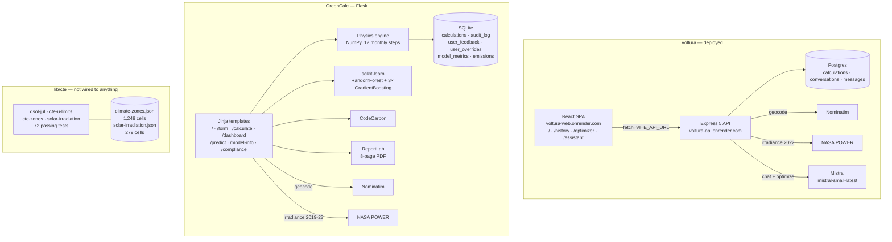

# Voltura — Ground Truth

> ## ⚠️ This is a dated snapshot, not a live description
>
> **Surveyed against `78c26d5` (2026-08-14). Production `main` has moved several
> times since.** A snapshot that is read as current is how a stale fact becomes a
> decision — that already cost one amendment (A12's superseded rollback target),
> and four claims in this file were found wrong at H1.1.
>
> **Corrections are marked inline** with ~~strikethrough~~ and a dated
> **CORRECTED** note. They are *not* rewritten silently: what the survey said and
> what turned out to be true are both part of the record, and the pattern in the
> errors is the useful part.
>
> Corrected 28 Aug 2026 (H1.1, in-repo half): the `roiYears: 7.5` claim; the
> "sessions / CORS / rate limiting — none" bullet; the dead-integrations bundle
> claim. Two of those describe code this session's own work changed
> (A14's deletions, F2's session scoping); two were wrong when written.
>
> Full inventory with verdicts and `path:line` on both sides:
> [`contracts/rulings/h1-claims-inventory-in-repo.md`](../contracts/rulings/h1-claims-inventory-in-repo.md).
> **Before relying on any claim here, check it against the code.**

**Purpose of this document.** It describes what is actually in the repository, for
someone who has never opened the code and who will write public material about the
project. It describes behaviour that the code produces, not intentions stated in
comments, commit messages, or marketing copy already present in the app. Where a
claim in the codebase is not supported by the code, that is called out.

**Repository:** `Green-Energy-Calc` (git, single branch `main`).
**Last commit at time of writing:** `78c26d5`, 2026-08-14.
**Document written:** 2026-08-19. Everything below reflects that commit.

Facts marked *(verified by running)* were confirmed by executing the code. Facts
marked *(read only)* were established by reading the source; the relevant runtime
(Python 3.11 with Flask, scikit-learn, etc.) is not installed on the machine this
was written on, so those parts could not be executed.

---

## 0. The single most important thing to understand first

**This repository contains two entirely separate applications that both calculate
solar savings, plus one standalone library that is not connected to either of
them.** They do not share code, data, a database, a language, or a deployment.
Nearly every ambiguity about "what Voltura does" comes from conflating them.

| # | Name in repo | Language / stack | Status | Where it lives |
|---|---|---|---|---|
| A | **Voltura** (`green-energy-calculator` + `api-server`) | React 19 + Vite; Express 5 + Postgres | Deployed (Render) | `artifacts/green-energy-calculator/`, `artifacts/api-server/` |
| B | **GreenCalc** | Python 3.11 Flask, SQLite, scikit-learn, ReportLab | Runnable; wired to the Replit run button | `artifacts/greencalc/` |
| C | **`@workspace/cte`** | TypeScript, zero runtime deps | Library only — **imported by nothing** | `lib/cte/` |
| D | `mockup-sandbox` | React | Four static design mockups | `artifacts/mockup-sandbox/` |
| E | `.migration-backup` | — | 182 committed files; a frozen copy of the pre-monorepo layout. Dead. | `.migration-backup/` |

The name **Voltura** appears in the browser title, the sidebar, and the AI system
prompts of application **A**. The EU AI Act work — audit logs, human-oversight
controls, model documentation, transparency notices — is almost entirely in
application **B**, which carries the name **GreenCalc** throughout its own UI. The
compliance engine with 72 tests is **C**, which no user can reach.

---

## 1. What it does

### 1.1 Voltura (application A) — the deployed product

A four-page React single-page app talking to an Express API. Deployment targets
referenced in the code are `https://voltura-web.onrender.com` (static site) and
`https://voltura-api.onrender.com` (API), on Render.

Routes are declared in [`src/App.tsx`](../artifacts/green-energy-calculator/src/App.tsx):
`/`, `/history`, `/optimizer`, `/assistant`, plus a catch-all 404. Every page is
wrapped in `Shell` ([`src/components/layout/Shell.tsx`](../artifacts/green-energy-calculator/src/components/layout/Shell.tsx)),
a sidebar with those four links under the "Voltura / Energy Intelligence" wordmark.

**`/` — Calculator.** The real flow, end to end:

1. The user fills in [`CalculatorForm`](../artifacts/green-energy-calculator/src/components/calculator/CalculatorForm.tsx):
   location (free text), annual kWh, PV watts, battery kWh (slider), tariff €/kWh,
   battery round-trip efficiency (slider), panel orientation (N/S/E/W dropdown),
   tilt angle (slider), optional installation cost. Validated client-side by Zod.
2. `POST /api/calculate` ([`routes.ts:366`](../artifacts/api-server/src/routes/routes.ts))
   parses the body against the same Zod schema, then:
   - geocodes the location string via **Nominatim** (OpenStreetMap), 6 s timeout;
     on failure it silently falls back to **lat 45, lon 10** — a point in northern Italy;
   - fetches monthly irradiance and temperature from **NASA POWER** for calendar
     year **2022 only**, 10 s timeout; on failure falls back to an analytic
     latitude curve and labels the source `"Estimated (lat-based)"`;
   - runs `simulate8760()` — a real hour-by-hour loop over 8,760 hours modelling
     PV generation, household consumption, and battery charge/discharge;
   - computes annual savings, CO₂ avoided, an installation cost estimate
     (€900/kWp + €500/kWh battery + €1,200 fixed), a 25-year ROI curve at 1.5 %
     electricity inflation, payback year, and one of three canned recommendation
     sentences chosen by coverage percentage;
   - writes the whole thing to Postgres and returns it.
3. [`ResultsDisplay`](../artifacts/green-energy-calculator/src/components/calculator/ResultsDisplay.tsx)
   renders KPI cards, a monthly generation/consumption bar chart, an energy-mix
   donut, and the 25-year ROI area chart (Recharts), plus a "Download Full PDF
   Report" button.

**`/history` — Calculation History.** `GET /api/history` returns every calculation
row in the database, newest first, rendered as a table with a per-row PDF download
button. There is no user account system, so this is a **global** history: every
visitor sees every other visitor's calculations.

**PDF report.** `GET /api/calculate/:id/pdf` builds a single-page-ish PDFKit
document (header band, summary table, results table, monthly breakdown table,
footer). It is generated from the stored row, not recomputed.

**`/optimizer` — AI Optimizer.** The user edits a location string and presses "Run
AI Optimization". The 24-hour load profile shown in the chart is a **fixed
constant** (`DEFAULT_PATTERN`, [`Optimizer.tsx:12`](../artifacts/green-energy-calculator/src/pages/Optimizer.tsx)) —
it is labelled "Standard Profile" and cannot be edited. `POST /api/optimize` sends
it plus the location to Mistral and renders three numbers and a paragraph. See §6
and §2 for what those numbers actually are.

**`/assistant` — Energy Assistant.** A chat window streaming from Mistral over
Server-Sent Events. See §6.

### 1.2 GreenCalc (application B) — the Flask app

Server-rendered Jinja templates, Flask blueprints, SQLite. Started by
`gunicorn -w 2 -b 0.0.0.0:5000 app:app`; this is what the Replit "Project" run
button launches.

Screens and endpoints, all in [`artifacts/greencalc/routes/`](https://github.com/elmaroun07-hub/voltura/blob/a464bb5/artifacts/greencalc/routes):

| Route | Method | What it does |
|---|---|---|
| `/` | GET | Marketing landing page (`index.html`) |
| `/form` | GET | The calculator input form, with a Leaflet map for picking coordinates |
| `/calculate` | POST | The main flow (below). Renders `results.html` |
| `/dashboard` | GET | Table of the last 50 calculations + computation-emissions KPIs |
| `/dashboard/data` | GET | JSON feed for the dashboard's Chart.js graphs |
| `/predict` | GET | HTML form for the hourly-consumption model |
| `/predict` | POST | **JSON API** (not a page — see §2) |
| `/model-info` | GET | JSON model card |
| `/model-info/page` | GET | HTML model card |
| `/shap-values` | GET/POST | JSON SHAP values for the hourly model |
| `/compliance` | GET | Feature-importance / SHAP explainability page |
| `/feedback` | POST | Thumbs up/down on a calculation |
| `/override` | POST | Record a human override of an output field |
| `/delete-my-data` | GET/POST | GDPR erasure page and action |
| `/admin/audit` | GET | Audit statistics JSON, gated by an `X-Admin-Token` header |
| `/export/pdf` | POST | 8-page ReportLab PDF, looked up by calculation UUID |
| `/export/pdf/<id>` | GET | Same PDF, looked up by integer id |

The `/calculate` flow ([`routes/calculator.py`](https://github.com/elmaroun07-hub/voltura/blob/a464bb5/artifacts/greencalc/routes/calculator.py)):
parse and validate ~15 form fields → geocode via Nominatim if no coordinates →
fetch NASA POWER (2019–2023 monthly means, cached in the Flask session) → look up
grid carbon intensity from a bounding-box country guess → run the **monthly**
(12-step) physics engine `calculate_energy()` wrapped in a CodeCarbon emissions
tracker → run two scikit-learn models → persist a `Calculation` row, a
`CalculationEmissions` row and an `AuditLog` row → render `results.html` with
charts, an "AI-assisted estimate" badge, a confidence interval, thumbs up/down,
editable override fields, a disclaimer box, and a "Recalculate without AI" button.

### 1.3 What a user cannot do anywhere

Sign up, log in, save anything privately, enter a building's construction details,
get a heat-habitability or summer-comfort assessment, or run a Spanish building
code (CTE) compliance check. Nothing in either UI reaches `lib/cte`.

---

## 2. Built / Partial / Not built

### Built and working

- **Voltura calculator** end to end: form → geocode → NASA POWER → 8,760-hour
  simulation → charts → Postgres. Real external data, real simulation.
- **Voltura history** page and its Postgres persistence.
- **Voltura PDF export** (PDFKit), reachable from both `/` and `/history`.
- **Voltura Assistant** — real streaming chat against Mistral, messages persisted
  in `conversations` / `messages` tables, tables created idempotently at boot
  ([`ensure-chat-tables.ts`](../artifacts/api-server/src/ensure-chat-tables.ts)).
- **GreenCalc calculator** end to end, including the 8-page ReportLab PDF, the
  emissions dashboard, and the audit log.
- **GreenCalc EU AI Act surface**: feedback, override, delete-my-data, model card,
  audit endpoint, AI badges and disclaimers. All wired and reachable (§5).
- **`lib/cte`** — the CTE DB-HE solar-control engine. 72 tests, all passing
  *(verified by running)*. It is genuinely finished for the scope it claims.
- **Test hardening for GreenCalc**: [`tests/conftest.py`](https://github.com/elmaroun07-hub/voltura/blob/a464bb5/artifacts/greencalc/tests/conftest.py)
  makes the whole Python suite offline and deterministic — no-op CodeCarbon,
  stubbed NASA/Nominatim, and a `requests.get` guard that raises if any live call
  leaks. This is careful work.

### Partial, or finished-looking but not what it appears

- ~~**`/optimizer` "Estimated ROI"** — the headline number is **hardcoded**.
  `optimize-payload.ts:48` sets `roiYears: 7.5` unconditionally.~~
  **CORRECTED 28 Aug 2026 (H1.1).** No longer true, and it may not have been
  true when written. `roiYears` and `7.5` are both **absent from shipped
  source** — `grep` over `artifacts/api-server/src` and
  `artifacts/green-energy-calculator/src` returns nothing for either. Gate H0's
  rendered-DOM probe against production independently reported
  `has7point5Years: false` ([`h0-gate-h0.md`](../contracts/rulings/h0-gate-h0.md)).
  `optimize-payload.ts:45-48` now parses only `optimalPv`, `optimalBattery` and
  `explanation`; there is no ROI field.
- **`/optimizer` fallback numbers** — same file, lines 46–47:
  `rec["optimal_pv_watts"] || 5000` and `rec["optimal_battery_kwh"] || 10`. If the
  model omits a field or returns `0`, the user is shown 5,000 W and 10 kWh as if
  the model had recommended them.
- **`/optimizer` load profile** — the "Typical Daily Usage Pattern" chart is a
  24-element constant. It is never derived from the user's data and cannot be
  edited. The chart is decoration.
- **Voltura's "ML consumption prediction"** — `mlPredictConsumption()`
  ([`routes.ts:56`](../artifacts/api-server/src/routes/routes.ts)) is a closed-form
  arithmetic expression (a cosine season factor × an hourly profile constant × a
  temperature term). There is no model, no training, no fitted parameters. The
  name is misleading.
- **GreenCalc panel tilt and orientation** — collected on the form, validated,
  stored in the database, and **discarded**.
  [`routes/calculator.py:137`](https://github.com/elmaroun07-hub/voltura/blob/a464bb5/artifacts/greencalc/routes/calculator.py) calls
  `panel_efficiency_factor(tilt, orientation)` and throws the return value away;
  `calculate_energy()` has no parameter for it. Tilt and orientation have zero
  effect on any GreenCalc number. The landing page says results are *"adjusted for
  your panel tilt and orientation."*
- **GreenCalc `/predict` HTML page** — `predict.html` posts to `/predict`, but the
  POST handler is the JSON API. Submitting the form shows the user a raw JSON
  blob. The template's `` branch is unreachable.
- **GreenCalc installation cost** — the engine uses `pv_w/1000 × €1,200` only
  ([`energy_model.py:284`](https://github.com/elmaroun07-hub/voltura/blob/a464bb5/artifacts/greencalc/models/energy_model.py)). Battery
  and wind capacity are collected and priced nowhere. A companion note in the
  workspace (`VOLTURA_fix3b_fix6_patch.md`) states that battery and wind costs
  were already included; in this commit they are not.
- **GreenCalc GDPR modal** — the "Decline (read-only)" button writes
  `sessionStorage` and closes the dialog. Nothing else in the app reads that flag,
  so declining changes no behaviour.
- **`lib/cte` construction defaults** — `CONSTRUCTION_DEFAULTS` is an empty frozen
  array with a `TODO(defaults)` and an explicit refusal to invent values. Same for
  `SOLAR_FACTORS`, which holds one entry marked unverified and is deliberately
  never consulted by the calculation. This is honest, documented incompleteness,
  not an oversight — but it does mean the library cannot yet assess an existing
  building without caller-supplied U-values and glazing factors.
- **`ZONE_BY_PROVINCE_ALTITUDE`** is documented in a large comment as
  "DELIBERATELY NOT IMPLEMENTED" — that comment is now stale; the table *is*
  populated from `climate-zones.json` directly beneath it.

### Not built

- **Authentication, accounts, authorization** — none, anywhere in Voltura.
  **CORRECTED 28 Aug 2026 (H1.1), three ways:**
  - ~~sessions — none~~ **Session *scoping* exists** and is enforced at four
    sites: `chat/routes.ts:39`, `routes/routes.ts:444` (`/api/calculate`),
    `:638` (`/api/history`) and `:288` (the PDF route, added at H-S). It is
    **not** authentication — `X-Session-Id` is client-supplied and never
    verified, so possession of an id is possession of the session. That is
    finding **F1**, gated by **C8**.
  - ~~`cors()` is enabled with no options, i.e. `Access-Control-Allow-Origin: *`~~
    **CORS is locked to a single required origin.** `app.ts:46` sets
    `origin: webOrigin`, `app.ts:50` restricts `allowedHeaders`, and a missing
    `WEB_ORIGIN` kills the process at boot rather than defaulting.
  - The "Rate limiting — none in either app" bullet below is **also wrong for
    Voltura**: `routes.ts:458` limits `/api/optimize` and `chat/routes.ts:58`
    limits the message route. It remains true for GreenCalc.
- **Rate limiting** — none in either app. (`RATELIMIT_deploy.md` in the parent
  folder describes adding Flask-Limiter; `flask-limiter` is not in
  `requirements.txt` and `Limiter` appears nowhere in the code.)
- **NASA response caching in GreenCalc** — `NASA_CACHE_deploy.md` describes a
  30-day coordinate cache with bounded timeouts. The code has neither; it has a
  15 s timeout and a per-user Flask-session cache only.
- **Postgres for GreenCalc** — `POSTGRES_SWAP_deploy.md` describes the swap;
  `config.py` still defaults to SQLite and `psycopg` is not in `requirements.txt`.
- **Internationalisation** — `artifacts/greencalc/static/lang/{en,es,ar}.json`
  exist and are complete-looking. No template, route, or script references them.
  Dead files.
- ~~**Audio, image, and batch AI integrations** — three complete integration
  packages ship in `artifacts/api-server/src/replit_integrations/`
  (`gpt-audio`, `gpt-4o-mini-transcribe`, `gpt-image-1`, an OpenAI batch
  helper). Dead code that pulls a second OpenAI client and two env vars
  (`AI_INTEGRATIONS_OPENAI_*`) into the bundle.~~
  **CORRECTED 28 Aug 2026 (H1.1), on both halves:**
  - **They never entered the bundle.** `AI_INTEGRATIONS`, `gpt-audio`,
    `gpt-image-1` and `gpt-4o-mini-transcribe` each appear **0 times** in
    `dist/index.mjs`. `build.mjs:17-23` traces from `src/index.ts`, and nothing
    imported those modules, so esbuild always tree-shook them out. The
    "pulls … into the bundle" claim was wrong when written, not merely stale.
  - **`audio/` and `image/` no longer exist.** Deleted under amendment **A14**
    at commit `594ce68`; only `chat/` (the shipped Assistant, G4) and `batch/`
    remain. Deleting them also removed a real hazard the original bullet missed:
    both clients read `AI_INTEGRATIONS_OPENAI_*`, and `openai@6.35.0` fills an
    `undefined` argument from `OPENAI_API_KEY` / `OPENAI_BASE_URL` and finally
    `https://api.openai.com/v1` (`client.js:71`, `:142`) — so wiring either
    module up with those vars unset would have silently routed to OpenAI.
- **`serveStatic`** in [`api-server/src/static.ts`](../artifacts/api-server/src/static.ts) — exported, never imported.
- **`@workspace/api-client-react`** — a generated React Query client and
  `@workspace/api-zod`, generated by Orval from an OpenAPI spec that describes
  exactly one endpoint (`/healthz`). The frontend declares the dependency and
  never imports it. The OpenAPI spec does not describe `/api/calculate`,
  `/api/history`, `/api/optimize`, or any chat route.
- **`scripts/src/hello.ts`** — prints "Hello from @workspace/scripts".
- **A wind model in Voltura** — GreenCalc has one (a latitude-banded capacity
  factor); the React app has no wind input at all.

### Things fed by fixtures or constants that look like live data

- The `/optimizer` energy pattern (constant array).
- The `/optimizer` ROI figure (constant `7.5`).
- GreenCalc's ML models are trained on **synthetic data generated at runtime**
  with `numpy.random.default_rng(42)` — there is no real training dataset in the
  repository. The model card at `/model-info` says so explicitly, which is to its
  credit, but "ML Predictions" on the landing page reads as though real data is
  involved.
- `artifacts/greencalc/models/rf_model.pkl` — a **3.9 MB trained model pickle
  committed to git**, and `artifacts/greencalc/instance/greencalc.db`, a committed
  SQLite database. Both are listed in `artifacts/greencalc/.gitignore`, which has
  no effect because they were tracked before the ignore rule existed.

---

## 3. The compliance engine

### Where it lives

`lib/cte/` — package name `@workspace/cte`. Four source modules and two test files:

- [`cte-zones.ts`](../lib/cte/src/cte-zones.ts) — CTE climate-zone model (winter letter α–E × summer digit 1–4), zone parsing/formatting, province + altitude → zone lookup.
- [`cte-u-limits.ts`](../lib/cte/src/cte-u-limits.ts) — maximum thermal transmittance (U-value) limits per envelope element per winter zone, plus airtightness limits.
- [`solar-irradiation.ts`](../lib/cte/src/solar-irradiation.ts) — the July solar irradiation tables (Hsol;jul) and compass-bearing → orientation mapping.
- [`qsol-jul.ts`](../lib/cte/src/qsol-jul.ts) — the qsol;jul solar-control calculation itself.

### What it actually asserts

**It is not imported by the Voltura app, the GreenCalc app, or anything else in
the repository.** It is compiled and type-checked by the root `tsc --build`, and
its tests run, but no user-facing code path reaches it.

Within its scope it does real regulatory work. `calculateQsolJul()` implements the
DB-HE formula

```
qsol;jul = Σₖ ( Fsh;obst · ggl;sh;wi · (1 − FF) · Aw;p · Hsol;jul ) / A_util
```

and compares the result against the code's limits (2.00 kWh/m²·month for private
residential use, 4.00 for other uses). It returns a discriminated union rather
than throwing or defaulting: every failure mode — no openings, bad floor area, an
out-of-range fraction, a missing irradiation row — comes back as a typed error
with the offending field named. The design principle, stated repeatedly in the
comments and enforced by the tests, is that the module **refuses to guess**.

The most substantive engineering in the package is around one specific hazard:
eleven CTE zone codes appear in both the peninsular and the Canary irradiation
tables with different values. For zone C2 facing south the peninsular figure is
88.17 and the Canary figure is 55.33 — a 59.4 % overstatement if the archipelago
is not resolved first. `archipelagoForProvince()` throws on an unrecognised
province rather than assuming peninsular, and `QsolJulInput.archipelago` is a
required field with no default.

### The real count

**72 tests. All 72 pass** *(verified by running `npx vitest run` in `lib/cte`,
2.46 s)*. So the number 72 is correct — but it refers to this library, not to the
EU AI Act work and not to the shipped applications.

Breakdown by `describe` block:

| Suite | Tests |
|---|---:|
| `orientationFromAzimuth — CTE figura 8 sectors` | 23 |
| `archipelago collision` | 7 |
| `Hsol;jul table integrity` | 6 |
| `calculateQsolJul — arithmetic` | 6 |
| `calculateQsolJul against the official tables` | 6 |
| `U-value limits` | 5 |
| `calculateQsolJul — refuses to guess` | 5 |
| `climate-zones coverage` | 5 |
| `parseZone` | 4 |
| `missing data throws rather than substituting` | 3 |
| `shading priority is computed, not assumed` | 2 |
| **Total** | **72** |

Four representative test names, verbatim:

- `archipelago collision > is 59.4% overstated for C2 south if the archipelago is ignored`
- `climate-zones coverage > resolves all 1,248 cells to a real irradiation row without throwing`
- `missing data throws rather than substituting > throws MissingIrradiationError for α4 and returns no number`
- `shading priority is computed, not assumed > does NOT rank south first in the Canaries`

That last one is worth understanding: in the Canaries in July, south is the
*darkest* vertical facade, so the intuitive "shade the south windows first"
heuristic is wrong there. The test proves the ranking comes out of the data rather
than out of an assumption.

### Other test suites in the repository

| Suite | Count | Status |
|---|---:|---|
| `lib/cte` (Vitest) | 72 | All pass *(verified by running)* |
| `artifacts/api-server` (Vitest) | 17 | All pass *(verified by running)* |
| `artifacts/greencalc` (pytest) | 192 test functions defined | *(read only — Python deps not installed here)* |

The GreenCalc breakdown by file: `test_energy_model.py` 59, `test_ml_model.py` 39,
`test_routes.py` 94. Within `test_routes.py`, 28 tests sit under the
`Block 6: EU AI Act Compliance` heading, 13 under PDF export, 13 under emissions
tracking, 12 under the predict API, 13 under form validation, 12 under page
availability, 3 under model-info.

One discrepancy I could not resolve: commit `13b1308`, which introduced the
offline test harness, records "191 passed in 68s", and the test files have not
changed since. I count 192 uniquely-named test functions and no skip markers. The
one-test gap is unexplained; someone should run the suite before quoting a number.
**The safe public statement is "72 tests in the CTE compliance engine" — that one
is verified.**

The api-server's 17 tests are all about one thing: surviving malformed LLM output
from `/api/optimize`. They are good tests. They do not test the calculation engine,
the routes, the database, or the chat, none of which have any test coverage.

---

## 4. Data layers

### Climate zones (CTE)

- **File:** [`lib/cte/src/climate-zones.json`](../lib/cte/src/climate-zones.json) — 52 Spanish provinces × 24 altitude bands = 1,248 cells, each a zone code like `"C3"`.
- **Source cited?** Yes, in code, not in the data file. `cte-zones.ts` cites *DB-HE, Anejo B* with the URL `https://www.codigotecnico.org/pdf/Documentos/HE/DccHE.pdf`. The JSON itself carries no provenance header.
- **Validation:** the loader `buildBands()` throws on an unparseable band label or zone code, so a corrupt file fails loudly at import. Tests assert the 1,248-cell shape, that every cell resolves to a real irradiation row, and that a fractional altitude (e.g. 1250.5 m) lands in a band — the altitude intervals are half-open and deliberately non-uniform (`1051-1250` is 200 m wide; the rest are 50 m).
- **Approximation / hardcoding:** none. Province keys use the INE inverted-article convention (`'Palmas, Las'`, `'Coruña, A'`) and must match exactly; this is documented and tested.

### Solar irradiation — July (Hsol;jul), CTE

- **File:** `SOLAR_IRRADIATION_JULY` in [`solar-irradiation.ts`](../lib/cte/src/solar-irradiation.ts), mirrored by `solar-irradiation.json`.
- **Source cited?** Yes, precisely: *DA DB-HE/1, enero 2020, tabla 20* (peninsular/Baleares/Ceuta/Melilla) and *tabla 21* (Canarias), Ministerio de Transporte, Movilidad y Agenda Urbana.
- **Provenance method, as stated in the file:** extracted from the official PDF by word geometry and cross-checked against a second independent extraction; all 279 cells agreed; no value typed by hand. I cannot independently verify the extraction, but the claim is specific and falsifiable.
- **Validation:** a test compares the TypeScript table against the JSON artifact cell for cell; further tests assert 12 peninsular zones and 19 Canary zones × 9 surfaces, that horizontal exceeds every vertical surface in July, and that Canary south is below peninsular south in every shared zone. Missing rows (e.g. zone α4, which the CTE simply does not publish) throw rather than return a fallback.
- **Approximation:** none.

### Solar irradiation — the two applications

Neither app uses the CTE tables. Both call **NASA POWER** live.

| | Voltura (TS) | GreenCalc (Python) |
|---|---|---|
| Parameters | `ALLSKY_SFC_SW_DWN`, `T2M` | same |
| Period | **2022 only** | 2019–2023, averaged per month |
| Timeout | 10 s | 15 s |
| Caching | none | Flask session, per user, per rounded coordinate |
| Fallback | analytic curve `max(2.5, 6.5 − |lat|·0.06)` × a cosine season term | four hardcoded latitude bands (5.5 / 5.0 / 3.8 / 2.8 kWh/m²/day) × a 12-element hardcoded seasonal shape |
| Fallback labelled to the user? | Yes — `irradianceSource` is shown as "Estimated (lat-based)" | Yes — `nasa_source` is surfaced on the results page |
| Source cited in code? | No | No |

Both fallbacks are approximations with no cited source. Both are honestly labelled
in the UI, which is the right behaviour.

### Grid emissions factors

Two independent tables, in two different units, that disagree with each other.

**GreenCalc:** [`artifacts/greencalc/data/grid_carbon_intensity.json`](https://github.com/elmaroun07-hub/voltura/blob/a464bb5/artifacts/greencalc/data/grid_carbon_intensity.json) —
32 ISO country codes plus `"DEFAULT": 400`, in **gCO₂/kWh**. No source cited in
the file or in any code comment. No date, no vintage. The country is chosen by
`country_from_latlon()`, which is a hand-written list of 34 rectangular
lat/lon bounding boxes evaluated in insertion order — a coarse approximation that
will misattribute anywhere borders are not rectangular. Tested only to the extent
that Spain resolves to 207 and an unknown point resolves to something positive.

**Voltura:** `CARBON_INTENSITY_BY_COUNTRY` in
[`lib/db/src/schema/schema.ts`](../lib/db/src/schema/schema.ts) — 33 keys
(including aliases like `maroc`, `uk`, `usa`) in **kgCO₂/kWh**, default `0.4`. No
source cited. Matched by **substring search against the location string**:

```ts
for (const [country, intensity] of Object.entries(CARBON_INTENSITY_BY_COUNTRY)) {
  if (loc.includes(country)) return intensity;
}
```

Because `india` is listed before `united states`, a location string containing
"Indiana" or "Indianapolis" resolves to India's factor (0.708) rather than the
United States' (0.386). *(read only — inferred from object key order, not executed.)*

The two tables disagree on the same countries: Spain is 207 g in GreenCalc and
244 g in Voltura; Morocco is 638 g vs 543 g; Portugal 180 g vs 212 g. Neither is
sourced, so neither can be defended.

GreenCalc's landing page claims *"Country-specific grid carbon intensity data for
35+ countries."* The file has 32 countries.

### Computation-carbon figures

GreenCalc wraps its engine call in **CodeCarbon** ([`models/carbon_tracker.py`](https://github.com/elmaroun07-hub/voltura/blob/a464bb5/artifacts/greencalc/models/carbon_tracker.py))
and persists a real measurement per calculation. If CodeCarbon is absent it falls
back to `duration × 10 W × 0.4 kgCO₂/kWh`. Voltura's equivalent is entirely
synthetic: `duration × 50 W × carbonIntensity`, with a floor of 1 mg, displayed as
"Computation CO₂".

---

## 5. EU AI Act compliance, concretely

### Where it exists

Essentially all of it is in the **Flask app**, and it is real code, not just
documentation. [`routes/compliance.py`](https://github.com/elmaroun07-hub/voltura/blob/a464bb5/artifacts/greencalc/routes/compliance.py)
opens with a header naming Articles 50, 14, 10 and 73.

**Logging and traceability (Art. 73).** An `audit_log` table
([`models/db_models.py`](https://github.com/elmaroun07-hub/voltura/blob/a464bb5/artifacts/greencalc/models/db_models.py)) with
timestamp, session id, endpoint, a SHA-256 input hash, a JSON output summary,
model version, `fallback_used`, `boundary_violation`, and measured emissions.
Written on every `/calculate` via [`models/audit_utils.py`](https://github.com/elmaroun07-hub/voltura/blob/a464bb5/artifacts/greencalc/models/audit_utils.py),
which is explicitly non-throwing. `GET /admin/audit` returns prediction volume,
fallback rate, boundary-violation rate, feedback sentiment, and the last 50
entries; it returns 403 unless `X-Admin-Token` matches the `ADMIN_TOKEN`
environment variable, and 403 when that variable is unset (so an unconfigured
deployment fails closed).

**Human oversight (Art. 14).** Three concrete mechanisms:
`POST /feedback` (thumbs up/down + comment, `user_feedback` table);
`POST /override` (records original vs. overridden value per field,
`user_overrides` table); and a **"Recalculate without AI"** button on the results
page that re-posts with `no_ml=1`, skipping both models and returning the
physics-only result.

**Transparency (Art. 50).** An `AI-assisted estimate` badge next to every
model-derived figure on `results.html`; a 90 % confidence interval on the PV
recommendation (from quantile regressors at α=0.1/0.9); a disclaimer box on the
page; a footer on every page reading *"This tool provides estimates only. Consult
a certified energy professional…"*; and a footer on every PDF page reading
*"AI-assisted estimate | Not financial advice | Model v… "*.

**Model documentation (Art. 10-adjacent).** `GET /model-info` and
`/model-info/page` ([`routes/predictions.py`](https://github.com/elmaroun07-hub/voltura/blob/a464bb5/artifacts/greencalc/routes/predictions.py))
return a genuine model card: algorithm, seed, training-sample count, feature list,
train/test split, geographic scope, intended use, **stated known bias**
("Underrepresented at lat > 60° … calibrated for residential scale only"), stated
known limitations, per-region MAE (Southern EU / Northern EU / North Africa), a
`regional_warning` flag that trips when the regional MAE spread exceeds 15 %, and
a contact address. Training runs also persist their metrics to a `model_metrics`
table.

**Data governance / GDPR.** Latitude and longitude are written to the database
**only** if the user ticks `store_location`; otherwise the columns are left null
and only a country code is kept. `CalculationEmissions` deliberately stores
country only. `/delete-my-data` deletes every calculation for the current session
id, cascading to emissions, feedback and overrides.

**Out-of-distribution handling.** `ML_TRAINING_BOUNDS` in
[`energy_model.py`](https://github.com/elmaroun07-hub/voltura/blob/a464bb5/artifacts/greencalc/models/energy_model.py) defines the
training envelope; inputs outside it set `boundary_violation`, which forces the
`/predict` endpoint down a physics fallback path and is recorded in the audit log.

**Refusal to over-claim.** In three places (`calculator.py`, `predictions.py`,
`export.py`) SHAP attribution for the PV model was deliberately removed, with a
comment explaining why: the model trains on synthetic data whose target depends
only on consumption, so attributing influence to irradiance or latitude would be
spurious. The code now states the physics drivers instead. This is the single most
compliance-relevant decision in the repository, and it is a decision to say less.

### Where it does not exist

**The deployed React/Express app has none of it.** Searching the entire
`green-energy-calculator/src` tree for "disclaimer", "estimate only", "not
financial", "AI-assisted", "AI-generated" or "consult" returns **zero matches**.
There is no audit log, no model documentation, no human-oversight control, no
confidence interval, no out-of-distribution guard, and no AI disclosure beyond the
words "AI Optimizer" in a nav item. Request logging (`pino-http`) records method,
path and status code only — not prompts, not completions, not model versions. The
chat system prompt tells the model that *"Voltura is an EU AI Act-compliant
energy-intelligence platform"*; nothing in that application implements it.

### Risk classification

No code performs a risk classification. The classification appears as **static
text**: the GreenCalc footer reads *"EU AI Act Compliant (Limited Risk, Article
50)"* and the landing page has an "EU AI Act — Fully compliant" tile. Both are
assertions in a template, not the output of any assessment.

### Honest summary for public material

GreenCalc's compliance layer is **specific, implemented features** — audit table,
override table, feedback table, token-gated audit endpoint, a real model card, an
opt-in for coordinates, a no-AI recalculation path — not merely architectural
discipline. That is a defensible claim, **about the Flask app**. The deployed
Voltura app has none of these, and saying "Voltura is EU AI Act compliant" without
that distinction would misrepresent the codebase. Nothing here constitutes a legal
conformity assessment, a declaration of conformity, or a registration; there is no
technical-documentation artefact of the kind Annex IV describes.

---

## 6. The AI features

Both live in `artifacts/api-server` and both talk to **Mistral** through the OpenAI
SDK pointed at `https://api.mistral.ai/v1`. Both use model **`mistral-small-latest`**
(the constant is declared twice —
[`routes.ts:24`](../artifacts/api-server/src/routes/routes.ts) and
[`chat/routes.ts:16`](../artifacts/api-server/src/replit_integrations/chat/routes.ts)).
The client is lazily constructed so a missing `MISTRAL_API_KEY` fails the request
rather than the boot.

### The Optimizer — `POST /api/optimize`

**Prompt.** System message: *"You are an expert energy consultant. Analyze the
energy usage pattern and location to recommend optimal solar and battery sizing.
Return JSON with exactly these keys: optimal_pv_watts (a number),
optimal_battery_kwh (a number), explanation (a single plain string of prose). The
explanation MUST be a string — never an object, never an array, never nested."*
User message: the location string and the JSON-serialised 24-element pattern.
`response_format: { type: "json_object" }`.

**Request validation.** None. The handler destructures `req.body` directly
([`routes.ts:524`](../artifacts/api-server/src/routes/routes.ts)); the Zod input
schema defined in `shared-routes.ts` is never applied on this route. Arbitrary
user text is interpolated into the prompt.

**What happens to the output.** It goes to `parseOptimizePayload()`
([`optimize-payload.ts`](../artifacts/api-server/src/routes/optimize-payload.ts)),
which is the best-engineered piece of the TypeScript codebase. It never throws.
It handles non-JSON, JSON arrays, and — the bug it was written for — `explanation`
arriving as a nested object or an array of bullets instead of a string. A
recursive `normalizeText()` flattens those into labelled prose; a companion
coercion accepts numbers-as-strings but rejects `null`, `{}` and `""` rather than
silently yielding `0`. On failure the route returns **502** with a fixed
user-facing sentence and logs the Zod detail server-side, specifically so
validation internals never reach the UI. 17 unit tests cover this, built around a
real production payload captured on 2026-08-03.

**But:** the two numeric fields fall back to `5000` and `10` on any falsy value,
and `roiYears` is `7.5`, hardcoded, always. The prompt does not ask for an ROI and
the model is never consulted about it.

**On API failure.** The outer `try/catch` returns **500** `{"message": "Failed to
generate optimization"}`. The frontend hook prefers the server's message and
otherwise shows "Optimization failed. Please try again in a moment." It uses
`safeParse` deliberately — a comment records that a raw `ZodError.message` had
previously been rendered into a toast.

### The Assistant — chat

**Prompt.** A ~200-word system prompt casting the model as "Voltura's Energy
Assistant", instructing it to prefer concrete numbers, to reason from consumption
patterns and irradiance and ~90 % battery round-trip efficiency, to use EUR and
metric units, to ask for missing inputs rather than guess, and to redirect
off-topic questions. It also asserts that Voltura is an EU AI Act-compliant
platform (see §5).

**Endpoints.** `GET/POST /api/conversations`, `GET/DELETE /api/conversations/:id`,
`POST /api/conversations/:id/messages`. The last one saves the user message,
replays the full conversation history to Mistral with `stream: true` and
`max_tokens: 2048`, forwards each delta over Server-Sent Events, then saves the
assembled assistant message.

**On API failure.** If the stream has not started, 500 JSON. If headers are
already sent, an SSE frame `{"error": "Failed to send message"}` and the stream is
closed. The client's `sendMessage` catches, logs to the console, and clears the
streaming flag — **the user sees no error at all**, just a message bubble that
stops arriving. The user's message has already been persisted at that point,
producing a conversation with a user turn and no reply.

**The serious problem.** The frontend calls `useChat(1)` —
[`ChatInterface.tsx:11`](../artifacts/green-energy-calculator/src/components/chat/ChatInterface.tsx),
with the comment `// Hardcoded ID for MVP demo`. Every visitor reads and writes
**conversation 1** in the shared production database. One user's chat history is
visible to the next. Separately, the component calls `createConversation.mutate()`
on every mount and discards the result, so the `conversations` table accumulates
an orphan "Energy Assistant Chat" row per page load. There is no authentication on
any conversation endpoint, so `DELETE /api/conversations/:id` is open to anyone.

---

## 7. HeatShield

**HeatShield does not exist as code.** The name appears exactly once in the entire
repository, in a comment in [`lib/cte/src/cte-zones.ts:15`](../lib/cte/src/cte-zones.ts):

> "the CTE sets U-value limits by WINTER zone only. The summer digit is under-used
> by the regulation itself. That asymmetry is the gap HeatShield exists to address
> — but it means we cannot lean on the CTE for summer thresholds. Do not invent
> them."

There is no HeatShield package, module, route, screen, test, or database table.
The git history shows the name being adopted and then walked back: commit
`5c9e78e` "Update site metadata: reflect HeatShield positioning" is followed by
`00532c7` "fix(web): remove unshipped Heat Habitability claim from metadata". The
current site metadata says "energy-intelligence platform for buildings" with no
HeatShield or habitability wording.

The honest description: **HeatShield is a planned product line.** `lib/cte` is
plausibly its first building block — the comments frame it that way — but the
library's own `index.ts` is emphatic about what it is not:

> "this package implements the DB-HE **solar control** check (qsol;jul) plus the
> winter-zone U-value limits. It does NOT produce a heat-habitability grade. The
> A–E letters here are CTE *winter climate zones* — an input describing the
> location — never an output describing the building."

Any public material that describes HeatShield as a product, a feature, or
something a user can use today would be describing something that does not exist
in this repository.

---

## 8. Architecture

### Workspace

pnpm workspace monorepo, Node 24, TypeScript 5.9. Packages are `artifacts/*`,
`lib/*`, `lib/integrations/*`, `scripts`. `pnpm run build` = root typecheck (a
`tsc --build` over `lib/db`, `lib/api-client-react`, `lib/api-zod`, `lib/cte`) then
a recursive per-package build. The Python app sits inside the same tree but is
outside the pnpm graph entirely; it has its own `requirements.txt` and `pytest.ini`.

### Data flow



### Key modules

**`artifacts/api-server`** — Express 5. `index.ts` boots (requires `PORT`, runs
`ensureChatTables()`, then `registerRoutes()`). `app.ts` mounts pino-http, wide-open
CORS, JSON body parsing, and a `/api` router that carries only `/healthz`. All
substantive routes are attached directly to the app inside `routes/routes.ts`
(568 lines, containing the geocoder, the NASA client, the 8,760-hour simulation,
the PDF generator, and the optimize handler). Built with esbuild into a single ESM
bundle; `pdfkit` and `fontkit` are externalised.

**`artifacts/green-energy-calculator`** — Vite + React 19 + Tailwind 3 + Wouter +
TanStack Query + Recharts + a full shadcn/ui component set. Its API types live in
`src/lib/api.ts`, deliberately duplicated from the server's `shared-routes.ts`
(both files carry a "keep in sync" comment) so the frontend never imports a
backend package.

**`lib/db`** — Drizzle schema for Postgres: `calculations`, `conversations`,
`messages`, plus the carbon-intensity constant. The client is lazily constructed
so that importing a Zod schema no longer requires a provisioned database — the
reasoning is documented at length in `lib/db/src/index.ts`, and the fail-fast
guard is kept separately in the server's own `db.ts`.

**`lib/api-spec` / `lib/api-zod` / `lib/api-client-react`** — Orval codegen from an
OpenAPI document describing a single health endpoint. Generated output is unused.

### External services

Nominatim (geocoding, both apps), NASA POWER (irradiance, both apps), Mistral
(both AI features), Google Fonts (~25 font families requested in one stylesheet
link in `index.html`), Leaflet + OpenStreetMap tiles from unpkg (GreenCalc form),
Chart.js (GreenCalc), and Postgres on Render.

### Deployment config

- `.replit` — Replit modules `nodejs-24` + `python-3.11`; the run button starts **only** the Flask app on port 5000; autoscale deployment target; a `postMerge` hook running `pnpm install --frozen-lockfile && pnpm --filter db push`.
- `artifacts/api-server/.replit-artifact/artifact.toml` — kind `api`, port 8080, production start `node artifacts/api-server/dist/index.mjs`, startup health check `/api/healthz`.
- `artifacts/green-energy-calculator/.replit-artifact/artifact.toml` — kind `web`, static serve from `dist/public`, SPA rewrite `/* → /index.html`.
- `artifacts/greencalc/.replit-artifact/artifact.edit.toml` — kind `web`, port 8000, gunicorn.
- Render is the actual host: `vite.config.ts` reads `RENDER_GIT_COMMIT` to stamp a build SHA into a `<meta name="build-sha">` tag, and `lib/db/migrations/2026-06-24_prod_catchup_manual.sql` is annotated "run against the Render Postgres (voltura-db)". There is one migration file and it was applied by hand through the Render SQL console.
- No CI configuration of any kind — no GitHub Actions, no test-on-push. The 89 passing TypeScript tests run only when someone runs them.

---

## 9. What's weak

### The three things I would fix first

**1. The shared chat conversation.** `useChat(1)` puts every visitor into
conversation id 1 in the production Postgres. Whatever one person types — a
postcode, a bill amount, an address — the next visitor sees on page load. Combined
with unauthenticated `DELETE /api/conversations/:id`, this is a live data-exposure
issue on a public URL, not a code-quality complaint. Fix: a session-scoped or
locally-stored conversation id, and authorization on the conversation routes. This
is a one-line comment (`// Hardcoded ID for MVP demo`) with a disproportionate
consequence.

**2. The hardcoded ROI.** `roiYears: 7.5` is displayed to users as "Estimated ROI
— 7.5 Years / Payback period based on current local rates". It is the same for
Madrid and for Tromsø. For a project whose stated differentiator is refusing to
present unverified numbers as results, this is the sharpest contradiction in the
repository — and the calculator on `/` already computes a real payback figure that
could be used instead. Fix: compute it, or remove the card.

**3. GreenCalc's discarded tilt and orientation.** The form asks for them, the
validator checks them, the database stores them, the landing page advertises them,
and `calculate_energy()` never receives them. Two panels, one facing south at 35°
and one facing north flat, produce identical output. Fix is small — thread the
existing `panel_efficiency_factor()` result into the generation term — but until
it is done, no GreenCalc number involving orientation should be quoted publicly.

### What a technical reader would notice on opening the repo

- **`.migration-backup/`** — 182 committed files reproducing the entire
  pre-monorepo `client/` + `server/` + `shared/` layout, including a duplicate
  shadcn component library. It is the first directory in an alphabetical listing.
- **A 3.9 MB `.pkl` and a SQLite `.db` committed to git**, both named in a
  `.gitignore` that cannot affect already-tracked files.
- **Two apps that do the same thing, differently.** Two solar engines (monthly
  vs. hourly), two carbon tables in two units that disagree, two NASA clients with
  different periods, two PDF generators (ReportLab and PDFKit), two geocoders. A
  reader's first question will be "which one is the product?" and the repo does
  not answer it.
- **`root/pyproject.toml` is 1,128 lines** of Replit-generated `tool.uv.sources`
  entries pinning several hundred unrelated PyTorch packages, for a project whose
  Python dependency list is 13 lines in a different file.
- **Dead weight in the shipped bundle** — audio, image and batch OpenAI
  integrations that are never registered; a generated API client that is never
  imported; `serveStatic` that is never called; `scripts/src/hello.ts`.
- **Three "deploy" markdown files in the parent folder** (`RATELIMIT_deploy.md`,
  `NASA_CACHE_deploy.md`, `POSTGRES_SWAP_deploy.md`) describing hardening work in
  the past tense that is not present in the code, plus
  `VOLTURA_fix3b_fix6_patch.md` listing as "ALREADY FIXED" at least two things
  (panel tilt, battery/wind costs in the ROI) that are not fixed. Anyone who reads
  those documents as a status report will be misled.
- **A comment that contradicts the code twenty lines later** —
  `ZONE_BY_PROVINCE_ALTITUDE` is headed "DELIBERATELY NOT IMPLEMENTED" and is then
  implemented.
- **Claims on GreenCalc's landing page that the code does not support**: "8760-hour
  simulation, hour-by-hour accuracy" (the Flask engine has 12 monthly steps — the
  8,760-hour loop is in the *other* application), "adjusted for your panel tilt and
  orientation" (discarded), "1.5% annual inflation" (the Flask engine uses 2 %),
  "35+ countries" (32), "EU AI Act — Fully compliant" (an assertion, not an
  assessment).
- **No CI.** 89 TypeScript tests and 192 Python tests, and nothing runs them
  automatically.
- **No request validation on `/api/optimize`**, wide-open CORS, no rate limiting,
  and no auth on any endpoint — on a public deployment whose two most expensive
  routes call a paid LLM API.
- Small stuff a reviewer will still mention: an unused `AlertTriangle` import and a
  dead `solarDirect` variable in the calculate handler; `MISTRAL_MODEL` declared
  twice; `createServer` imported into `routes.ts` and unused; a
  `useQuery` in `Home.tsx` that omits the `API_BASE` prefix every other call uses,
  so the PDF button on the calculator page will not appear in the split-origin
  production deployment.

### Where I am uncertain

- I could not execute the Python suite (no Flask/scikit-learn on this machine), so
  the 192-vs-191 test-count discrepancy is unresolved and I cannot confirm the
  Python tests currently pass.
- The claim that the CTE irradiation tables were extracted by word geometry and
  double-checked cell-for-cell against the official PDF is credible and internally
  consistent, but I verified only that the TypeScript table matches the JSON
  artifact — not that either matches the ministry's PDF.
- I have not confirmed what is actually live at `voltura-web.onrender.com` or
  `voltura-api.onrender.com`; everything here describes commit `78c26d5` in the
  working tree.
- The "Indiana matches India" carbon-intensity bug is inferred from JavaScript
  object key ordering and the substring match; I did not run it.
